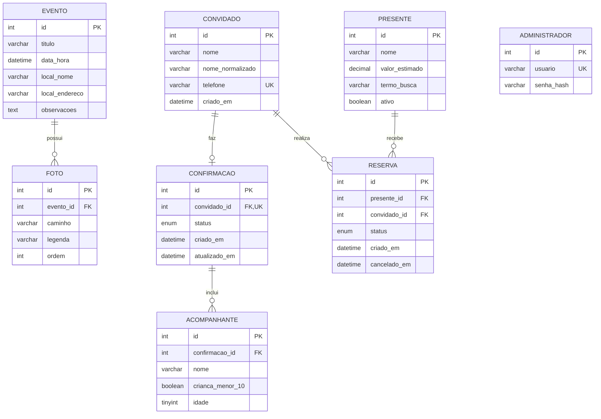

# Modelo de Dados — GetMarried.com

| Campo | Valor |
|---|---|
| Versão do documento | 0.1 (rascunho) |
| Data | 17/11/2026 |
| Banco de dados | MySQL 8 |
| Base | `docs/requisitos.md` v0.1 |

## 1. Diagrama entidade-relacionamento



> `ADMINISTRADOR` não se relaciona com as demais tabelas: ele só controla o acesso ao painel dos noivos.

## 2. Dicionário de dados

### EVENTO
Informações exibidas na tela inicial. Terá um único registro.

| Coluna | Tipo | Regras | Descrição |
|---|---|---|---|
| id | INT | PK, auto incremento | Identificador |
| titulo | VARCHAR(120) | obrigatório | Nome do evento |
| data_hora | DATETIME | obrigatório | Data e horário do casamento |
| local_nome | VARCHAR(150) | obrigatório | Nome do local |
| local_endereco | VARCHAR(255) | obrigatório | Endereço |
| observacoes | TEXT | opcional | Dress code, avisos, informações gerais |

### FOTO
| Coluna | Tipo | Regras | Descrição |
|---|---|---|---|
| id | INT | PK | Identificador |
| evento_id | INT | FK → EVENTO | Evento ao qual pertence |
| caminho | VARCHAR(255) | obrigatório | Caminho do arquivo da imagem |
| legenda | VARCHAR(150) | opcional | Texto da foto |
| ordem | INT | padrão 0 | Ordem de exibição |

### CONVIDADO
| Coluna | Tipo | Regras | Descrição |
|---|---|---|---|
| id | INT | PK | Identificador |
| nome | VARCHAR(120) | obrigatório | Nome informado no primeiro acesso |
| nome_normalizado | VARCHAR(120) | obrigatório | `nome` em minúsculas, sem acentos e sem espaços extras; usado só para comparar o nome nos acessos seguintes (RN09) |
| telefone | VARCHAR(15) | **único**, obrigatório | Somente dígitos (ex.: `19999998888`); identifica o convidado |
| criado_em | DATETIME | padrão agora | Data do primeiro acesso |

### PRESENTE
| Coluna | Tipo | Regras | Descrição |
|---|---|---|---|
| id | INT | PK | Identificador |
| nome | VARCHAR(150) | obrigatório | Nome do produto |
| valor_estimado | DECIMAL(10,2) | obrigatório, maior que 0 | Valor informado pelos noivos (RN07) |
| termo_busca | VARCHAR(200) | opcional | Texto usado na busca web; se vazio, usa o `nome` |
| ativo | BOOLEAN | padrão verdadeiro | `falso` = removido da lista (exclusão lógica) |

O link de busca é montado pela aplicação a partir do `termo_busca` (ou do `nome`); não é gravado no banco.

### RESERVA
| Coluna | Tipo | Regras | Descrição |
|---|---|---|---|
| id | INT | PK | Identificador |
| presente_id | INT | FK → PRESENTE | Presente reservado |
| convidado_id | INT | FK → CONVIDADO | Quem reservou |
| status | ENUM('ATIVA','CANCELADA') | padrão `ATIVA` | Situação da reserva |
| criado_em | DATETIME | padrão agora | Quando reservou |
| cancelado_em | DATETIME | opcional | Quando cancelou |
| presente_ativo | INT | coluna gerada, **única** | Vale `presente_id` quando `ATIVA`, senão `NULL` |

**Como garante RN01 e RF15:** o índice único em `presente_ativo` impede duas reservas ativas do mesmo presente. Se dois convidados tentarem ao mesmo tempo, o MySQL aceita uma e rejeita a outra. Reservas canceladas ficam como histórico (`NULL` não conflita).

### CONFIRMACAO
| Coluna | Tipo | Regras | Descrição |
|---|---|---|---|
| id | INT | PK | Identificador |
| convidado_id | INT | FK → CONVIDADO, **único** | Um convidado, uma confirmação (RN05) |
| status | ENUM('CONFIRMADA','CANCELADA') | padrão `CONFIRMADA` | Permite cancelar (RF22) |
| criado_em | DATETIME | padrão agora | Quando confirmou |
| atualizado_em | DATETIME | atualiza sozinho | Última alteração |

### ACOMPANHANTE
| Coluna | Tipo | Regras | Descrição |
|---|---|---|---|
| id | INT | PK | Identificador |
| confirmacao_id | INT | FK → CONFIRMACAO, exclusão em cascata | Confirmação do titular |
| nome | VARCHAR(120) | obrigatório | Nome do acompanhante |
| crianca_menor_10 | BOOLEAN | obrigatório | Verdadeiro se tiver menos de 10 anos |
| idade | TINYINT | de 0 a 9; obrigatória só se criança | Idade da criança (RN03) |

### ADMINISTRADOR
| Coluna | Tipo | Regras | Descrição |
|---|---|---|---|
| id | INT | PK | Identificador |
| usuario | VARCHAR(50) | único, obrigatório | Login dos noivos |
| senha_hash | VARCHAR(255) | obrigatório | Senha **criptografada com hash**, nunca em texto puro |

## 3. Decisões de modelagem

| # | Decisão | Motivo |
|---|---|---|
| 1 | **Código de acesso fora do banco**, na variável `CODIGO_ACESSO` do `.env` | Segue o RNF03 (segredos no `.env`). Para trocar o código, basta alterar a variável e reiniciar |
| 2 | Convidado identificado pelo **telefone**; no retorno, nome e telefone devem coincidir com o cadastro | Telefone é único. Se o telefone existe com outro nome, o acesso é negado com aviso (RF31) |
| 3 | Reserva cancelada **não é apagada** | Mantém histórico e permite auditar quem reservou o quê |
| 4 | Presente removido por **exclusão lógica** (`ativo`) | Não perde o histórico de reservas antigas |
| 5 | Titular da confirmação **não é gravado como acompanhante** | Ele já é o `CONVIDADO`; só os demais entram em `ACOMPANHANTE` |
| 6 | Validações no banco (`CHECK`, `UNIQUE`) além da aplicação | O banco é a última barreira contra dados inválidos |
| 7 | Coluna `nome_normalizado` | Evita bloquear o convidado por diferença de maiúsculas, acento ou espaço; a normalização é feita pela aplicação ao gravar e ao comparar |

## 4. Cálculo dos totais (RF25)

- **Adultos** = 1 (o titular) + acompanhantes com `crianca_menor_10 = falso`
- **Crianças** = acompanhantes com `crianca_menor_10 = verdadeiro`
- Considerar apenas confirmações com status `CONFIRMADA`.

Premissa: o convidado titular é sempre adulto. Se isso mudar, será preciso registrar a idade do titular.

## 5. Script de criação (rascunho)

Será o conteúdo de `db/init.sql`, executado automaticamente pelo Docker.

```sql
CREATE DATABASE IF NOT EXISTS getmarried
  CHARACTER SET utf8mb4 COLLATE utf8mb4_unicode_ci;
USE getmarried;

CREATE TABLE evento (
  id              INT AUTO_INCREMENT PRIMARY KEY,
  titulo          VARCHAR(120) NOT NULL,
  data_hora       DATETIME     NOT NULL,
  local_nome      VARCHAR(150) NOT NULL,
  local_endereco  VARCHAR(255) NOT NULL,
  observacoes     TEXT
);

CREATE TABLE foto (
  id         INT AUTO_INCREMENT PRIMARY KEY,
  evento_id  INT          NOT NULL,
  caminho    VARCHAR(255) NOT NULL,
  legenda    VARCHAR(150),
  ordem      INT          NOT NULL DEFAULT 0,
  FOREIGN KEY (evento_id) REFERENCES evento(id)
);

CREATE TABLE convidado (
  id         INT AUTO_INCREMENT PRIMARY KEY,
  nome       VARCHAR(120) NOT NULL,
  nome_normalizado VARCHAR(120) NOT NULL,
  telefone   VARCHAR(15)  NOT NULL UNIQUE,
  criado_em  DATETIME     NOT NULL DEFAULT CURRENT_TIMESTAMP
);

CREATE TABLE presente (
  id              INT AUTO_INCREMENT PRIMARY KEY,
  nome            VARCHAR(150)  NOT NULL,
  valor_estimado  DECIMAL(10,2) NOT NULL CHECK (valor_estimado > 0),
  termo_busca     VARCHAR(200),
  ativo           BOOLEAN       NOT NULL DEFAULT TRUE
);

CREATE TABLE reserva (
  id            INT AUTO_INCREMENT PRIMARY KEY,
  presente_id   INT NOT NULL,
  convidado_id  INT NOT NULL,
  status        ENUM('ATIVA','CANCELADA') NOT NULL DEFAULT 'ATIVA',
  criado_em     DATETIME NOT NULL DEFAULT CURRENT_TIMESTAMP,
  cancelado_em  DATETIME,
  -- vale presente_id só quando ATIVA; NULL não conflita no índice único
  presente_ativo INT GENERATED ALWAYS AS
    (IF(status = 'ATIVA', presente_id, NULL)) STORED,
  UNIQUE KEY uq_reserva_ativa (presente_ativo),
  FOREIGN KEY (presente_id)  REFERENCES presente(id),
  FOREIGN KEY (convidado_id) REFERENCES convidado(id)
);

CREATE TABLE confirmacao (
  id             INT AUTO_INCREMENT PRIMARY KEY,
  convidado_id   INT NOT NULL UNIQUE,
  status         ENUM('CONFIRMADA','CANCELADA') NOT NULL DEFAULT 'CONFIRMADA',
  criado_em      DATETIME NOT NULL DEFAULT CURRENT_TIMESTAMP,
  atualizado_em  DATETIME NOT NULL DEFAULT CURRENT_TIMESTAMP
                          ON UPDATE CURRENT_TIMESTAMP,
  FOREIGN KEY (convidado_id) REFERENCES convidado(id)
);

CREATE TABLE acompanhante (
  id                INT AUTO_INCREMENT PRIMARY KEY,
  confirmacao_id    INT          NOT NULL,
  nome              VARCHAR(120) NOT NULL,
  crianca_menor_10  BOOLEAN      NOT NULL,
  idade             TINYINT,
  FOREIGN KEY (confirmacao_id) REFERENCES confirmacao(id) ON DELETE CASCADE,
  CONSTRAINT ck_idade_crianca CHECK (
    (crianca_menor_10 = FALSE AND idade IS NULL) OR
    (crianca_menor_10 = TRUE  AND idade BETWEEN 0 AND 9)
  )
);

CREATE TABLE administrador (
  id          INT AUTO_INCREMENT PRIMARY KEY,
  usuario     VARCHAR(50)  NOT NULL UNIQUE,
  senha_hash  VARCHAR(255) NOT NULL
);
```

> O script usa recursos do MySQL 8 (coluna gerada e `CHECK`). Por isso a ficha técnica indica **MySQL 8** e o Docker usará a imagem `mysql:8`.

## 6. Pontos em aberto

| # | Ponto | Sugestão |
|---|---|---|
| 1 | ~~Telefone igual com nome diferente~~ | **Decidido:** bloquear com aviso para digitar o nome corretamente (RF31); noivos podem corrigir nomes cadastrados errado (RF32) |
| 2 | Tabela de **embeddings** para sugestão de presentes por IA | Definir na etapa do módulo de IA |
| 3 | O texto do casamento usado pelo assistente (RAG) | Fica no arquivo `data/casamento.md`, fora do banco |
